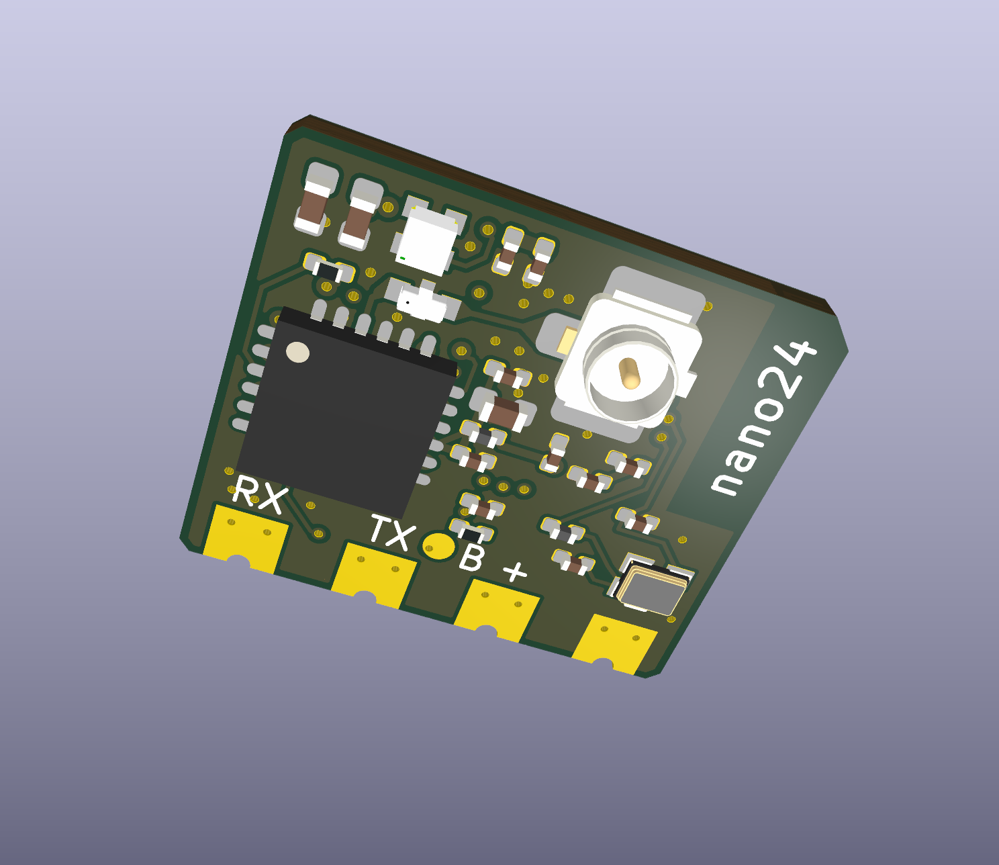
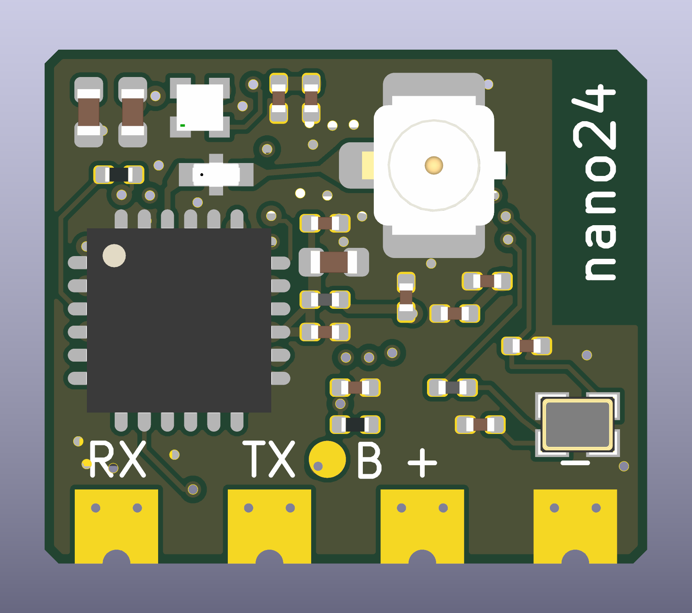
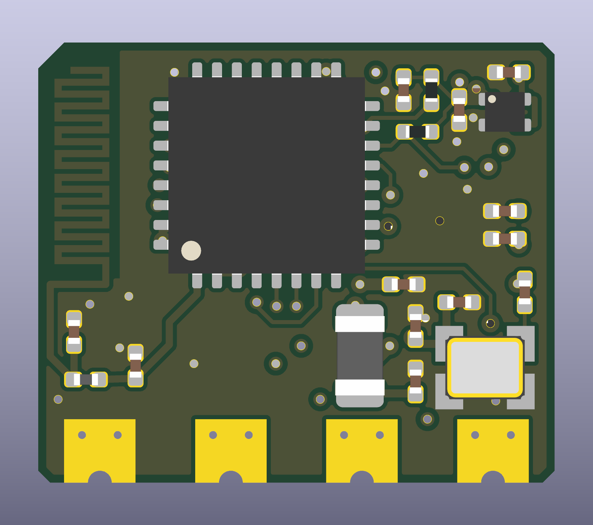

# nano24 — 2.4 GHz ExpressLRS Receiver

A compact receiver hardware project from **Anthony Sprinkler**, built around an **ESP32-C3FH4** and **SX1281**. The PCB measures **13 × 11.1 mm** and connects to a flight controller through four bottom-edge CRSF cable pads.

**Status: untested hardware prototype.** CAD checks pass, but no assembled board has been powered, flashed or RF-tested. The custom printed Wi-Fi antenna and its matching network require measurement and tuning. No ready-to-flash firmware binary is included. Manufacturing files are provided for prototype review and quotation.



*CAD render of the proposed assembly; this is not a photograph of working hardware.*

[Open the schematic](exports/schematic/ELRS-Receiver.svg) · [View the PCB](ELRS-Receiver.kicad_pcb) · [BOM](exports/ELRS-Receiver-BOM.csv) · [Prototype Gerbers](exports/pcb/nano24-Gerbers-PROTOTYPE.zip) · [Test plan](TESTING.md)

## Hardware overview

| Feature | Current design |
| --- | --- |
| ELRS band | 2.4 GHz |
| Microcontroller | Espressif ESP32-C3FH4 |
| Radio | Semtech SX1281IMLTRT, single radio |
| Main ELRS antenna | External 2.4 GHz antenna through J1, U.FL connector |
| Wi-Fi antenna | Custom printed meander on B.Cu, integral PCB copper |
| Flight-controller interface | Full-duplex UART, CRSF, 3.3 V logic |
| Power input | Regulated 5 V through the `+` pad |
| Onboard regulator | TLV75533PDQNR, 3.3 V output |
| Clocks | 40 MHz MCU crystal; 52 MHz radio TCXO |
| Indication | RGB LED |
| Outline | 13 × 11.1 mm, chamfered corners |
| Proposed construction | Six copper layers, nominal 1.0 mm thickness |
| Assembly | 41 purchased parts: 22 front, 19 back |
| Wire connections | Four 1.8 × 1.6 mm lands with 0.6 mm castellated edge holes |
| Hardware revision | 0.4 in engineering metadata; board marking is simply `nano24` |

**The printed antenna serves Wi-Fi configuration and updates. The ELRS radio link uses a separate external antenna at J1.**

The circuit and parts of the dense core layout derive from [OpenDrone OpenRX Lite-UFL](https://github.com/OpenDrone-hw/OpenRX-Lite-UFL). This derivative changes the outline, antenna, cable pads and portions of the placement/routing. Full provenance is in [NOTICE.md](NOTICE.md). RadioMaster RP1 photographs informed packaging decisions; this is not a RadioMaster PCB reconstruction.

## Board views

| Front | Back |
| --- | --- |
|  |  |

The four cable-pad labels read **RX, TX, +, −** from left to right when viewed from the front with the U.FL connector toward the top. The printed Wi-Fi radiator is on the back along the edge opposite the main component cluster.

For closer inspection, see the [front copper plot](exports/pcb/PCB-top.svg), [back copper plot](exports/pcb/PCB-bottom.svg), [front assembly drawing](exports/pcb/PCB-assembly-top.svg) and [back assembly drawing](exports/pcb/PCB-assembly-bottom.svg). Bottom SVGs are mirrored for viewing from the physical back; manufacturing coordinates use one common board frame.

## Open and edit in KiCad

1. Install **KiCad 10** with its standard footprint and 3D-model libraries. The current files were checked with KiCad **10.0.7**.
2. Clone this repository or download and extract its ZIP.
3. Open [ELRS-Receiver.kicad_pro](ELRS-Receiver.kicad_pro) in KiCad.
4. Open [ELRS-Receiver.kicad_sch](ELRS-Receiver.kicad_sch) for the schematic or [ELRS-Receiver.kicad_pcb](ELRS-Receiver.kicad_pcb) for the PCB.
5. In PCB Editor, use **View → 3D Viewer** to inspect the assembly.

The native filenames retain the original `ELRS-Receiver` project basename. Project-local symbols, footprints and available custom models are included under [libraries/](libraries/), with relative library tables. Standard model references use KiCad's `KICAD10_3DMODEL_DIR`.

## Connect to a flight controller

| PCB marking | Reference | Connect to |
| --- | --- | --- |
| `RX` | TP1 | FC UART **TX** |
| `TX` | TP2 | FC UART **RX** |
| `+` | TP3 | Regulated **5 V** |
| `−` | TP4 | **GND** |
| `B` / round front pad | TP5 | BOOT / GPIO9; temporarily connect to GND for first flashing or recovery |

Use **3.3 V UART signal levels**. The `+` pad feeds the onboard regulator; it is not a direct battery input. The regulator's maximum operating input is 5.5 V. Provide strain relief for the soldered cable.

For Betaflight, enable **Serial RX** on the connected UART and select **Serial / CRSF** as the receiver mode/provider. Both signal wires are needed for communication in both directions, including FC-issued commands. See the [official ELRS FC setup guide](https://www.expresslrs.org/quick-start/receivers/configuring-fc/).

## Firmware and first flash

**The repository currently contains a hardware pin map, not a compiled firmware release or a registered nano24 Configurator target.**

The intended build family is **`Unified_ESP32C3_2400_RX`**, with [firmware/receiver-hardware.json](firmware/receiver-hardware.json) packaged into the firmware for this board. Selecting an arbitrary ESP32-C3 receiver target is not sufficient: its pin assignments and power configuration must match. RadioMaster RP1 ESP8285 firmware is incompatible with this MCU.

The first-flash workflow, once a complete board-specific UART image has been built, is:

1. Disconnect the receiver from the FC and fit the external ELRS antenna.
2. Connect a USB-to-UART adapter: adapter **TXD → RX**, **RXD → TX**, and **GND → −**. The adapter must use 3.3 V logic.
3. Supply regulated **5 V → +**, sharing ground with the adapter.
4. Connect **B → GND before applying power** to enter the ESP32-C3 ROM download mode.
5. Flash the complete board-specific image using its generated flash instructions, including the correct bootloader and partition data.
6. Remove the B-to-GND connection and power-cycle the receiver.

Later updates are intended to use UART, Betaflight passthrough or Wi-Fi. These paths remain untested on nano24. Wi-Fi operation also depends on the custom printed antenna performing adequately.

See [firmware/README.md](firmware/README.md) for the pin table, firmware work still needed and binding behavior. Reference: [ELRS ESP32-C3 build targets](https://github.com/ExpressLRS/ExpressLRS/blob/master/src/targets/esp32c3-rx.ini) and [Espressif download-mode guidance](https://docs.espressif.com/projects/esptool/en/latest/esp32c3/advanced-topics/boot-mode-selection.html).

## Binding

A physical bind button is not required. The intended options are:

- **Binding phrase:** configure the same phrase on the receiver and transmitter, using compatible firmware versions.
- **Betaflight:** support was introduced with ELRS 3.4.0, Betaflight 4.5.0 and Configurator 10.10. Use **Bind Receiver** or `bind_rx`, then **Bind** in the transmitter's ELRS Lua script.
- **Fresh unbound receiver:** ELRS can enter bind mode automatically when it has no saved binding or preset phrase. A previously bound receiver waiting for an absent transmitter is a different state.
- **Three quick power cycles:** the standard ELRS manual binding procedure, subject to firmware settings.

The `B` pad is GPIO9/BOOT. The current hardware JSON does **not** define a runtime button assignment, so a long-press binding action on B is not currently configured. Holding it low during startup enters the MCU bootloader instead.

The familiar delayed Wi-Fi startup is separate from binding. See the [official binding guide](https://www.expresslrs.org/quick-start/binding/) and [Web UI guide](https://www.expresslrs.org/quick-start/webui/). These are expected firmware capabilities, not completed nano24 hardware tests.

## Printed antenna and RF limits

AE1 replaces a purchased ceramic Wi-Fi antenna with a **custom meandered monopole prototype**. Its footprint is a single connected copper feature, excluded from the purchased BOM and pick/place data.

- Radiator: B.Cu, 0.18 mm trace width, 25.1 mm centreline length.
- Clearance strip: **2.05 × 5.7 mm** on all six copper layers, excluding plane fills and vias.
- Initial matching: **C21 = 1.2 pF, C22 = 1.2 pF, L2 = 2.5 nH**.
- Those values are provisional populations inherited from the reference circuit. They have **not** been matched to this printed radiator.

No antenna simulation, VNA tuning, radiated-efficiency measurement, sensitivity test or range test has been performed. Keep the antenna strip clear of nearby metal, batteries and wires in the eventual installation. Full dimensions, rationale and measurement requirements are in [ANTENNA-DESIGN.md](ANTENNA-DESIGN.md); the generated path is in [references/antenna-geometry.json](references/antenna-geometry.json).

## Fabrication and assembly files

| File or directory | Purpose |
| --- | --- |
| [Prototype Gerber ZIP](exports/pcb/nano24-Gerbers-PROTOTYPE.zip) | Six copper layers, masks, pastes, silkscreens, outline and drill files |
| [Manufacturing plots](exports/pcb/manufacturing/) | Individual fabrication files |
| [Schematic BOM](exports/ELRS-Receiver-BOM.csv) | Values, manufacturer parts, supplier fields and matching notes |
| [Assembler BOM](exports/pcb/JLCPCB-BOM.csv) | JLCPCB-format reference BOM |
| [Assembler CPL](exports/pcb/JLCPCB-CPL.csv) | Both-side component positions and native CAD rotations |
| [Native placement CSV](exports/pcb/ELRS-Receiver-positions.csv) | Original KiCad component placement output |

This board requires **double-sided precision assembly**, including 0201 components, and **filled/copper-capped via-in-pad processing**. The four 0.60 mm castellated edge holes must stay open; the smaller stitching/via-in-pad holes need the agreed filling treatment. Panel support, castellation manufacture, stack-up, RF impedance, fine silkscreen, rotations and sourcing require assembler/fabricator review.

The proposed stack is six layers at nominal 1.0 mm. It is not a confirmed fabricator stack code. BOM supplier fields are inherited selections, not verified current stock. The RF filter procurement replacement and RGB LED selection still need review. Read [FABRICATION-NOTES.md](FABRICATION-NOTES.md) before requesting a prototype quote.

## Verification and remaining tests

| Check | Recorded result |
| --- | --- |
| Schematic ERC | 0 violations |
| PCB DRC | 0 violations |
| Unconnected PCB items | 0 |
| Schematic/PCB parity findings | 0 |
| Physical net membership and firmware pin-map audit | Passed |
| Antenna strip / nearby ground-reference-layer geometry audit | Passed |
| Power-up and current consumption | Not tested |
| Firmware build and first flash | Not completed |
| CRSF, binding, telemetry and failsafe | Not tested |
| Antenna matching, sensitivity, Wi-Fi and range | Not tested |

Check reports are in [exports/ERC.json](exports/ERC.json), [exports/pcb/DRC.json](exports/pcb/DRC.json) and [exports/verification.json](exports/verification.json). They establish CAD connectivity and geometry, **not a functioning or flight-qualified receiver**.

The next work is documented in [TESTING.md](TESTING.md): source/DFM review, initial power-up, firmware packaging, clock verification, CRSF and binding tests, RF tuning, sensitivity and failsafe characterization. Record actual measurements and the tested hardware/firmware versions before changing a test to “passed.”

## Repository layout

```text
ELRS-Receiver.kicad_pro / .kicad_sch / .kicad_pcb
libraries/          Local symbols, footprints and custom 3D models
firmware/           Hardware pin mapping and flashing notes
references/         Generated antenna geometry
exports/            Schematic, BOM, PCB views and fabrication review files
tools/              CAD export and independent audit helpers
ANTENNA-DESIGN.md    Printed-antenna details and tuning requirements
FABRICATION-NOTES.md Stack, castellation and assembly requirements
TESTING.md          Hardware validation plan and results status
NOTICE.md           Source attribution and modification history
LICENSE             CERN-OHL-S-2.0 hardware license
```

Local KiCad session files, backups, temporary migration scripts, credentials and manufacturer datasheet PDF copies are excluded. See [tools/README.md](tools/README.md) for regenerating checks and exports, and [CONTRIBUTING.md](CONTRIBUTING.md) for contributing changes.

## Attribution and license

The hardware derives from **OpenDrone OpenRX Lite-UFL** and is distributed under **CERN-OHL-S-2.0**, preserving the upstream license and attribution. Source commits and modifications are recorded in [NOTICE.md](NOTICE.md). Standard KiCad library-derived assets retain the KiCad library licensing and exception described there.

ExpressLRS firmware is a separate upstream project with its own license; this repository does not include its firmware source or compiled binaries. nano24 is an independent Anthony Sprinkler project, with no claim of endorsement by ExpressLRS, OpenDrone or RadioMaster.
